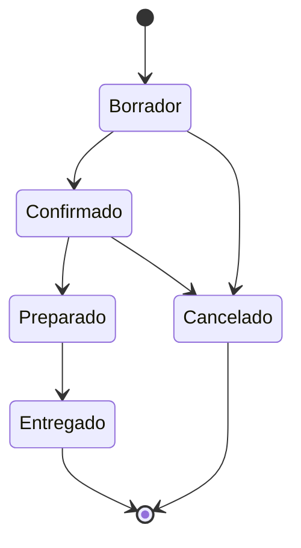
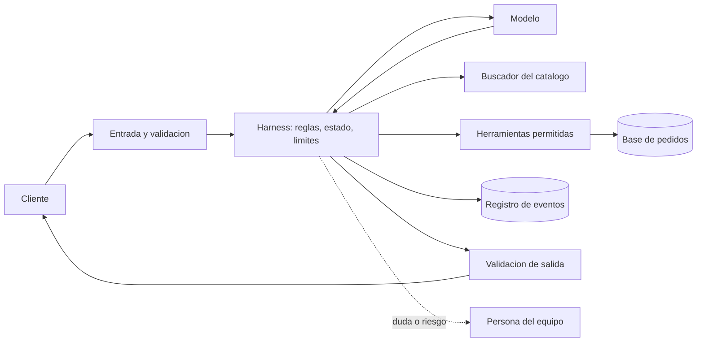
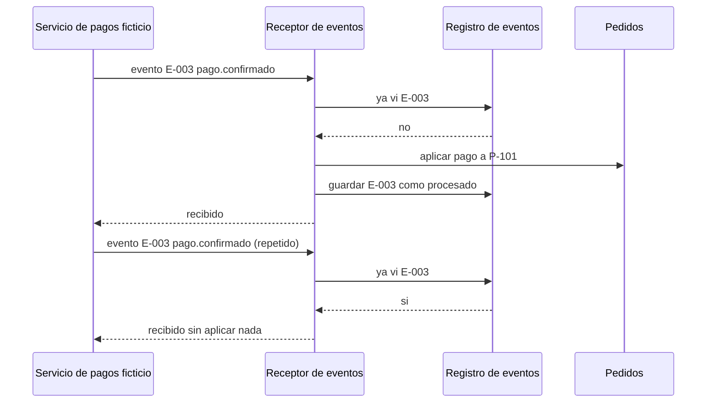

# Clase 27 · Apuntes del profesor

> Marcas: ✅ verificado · ⚠️ por verificar · 🧪 ejemplo inventado · 🎓 para ti (profundidad extra).
> Enlaces en `fuentes.md`. La panadería "La Espiga Dorada" y sus datos son ficticios 🧪.

---

## 0. Idea que sostiene la clase

**El modelo propone; el sistema dispone.**

Principio del curso: el ingeniero verifica. Aquí, verificar significa **poner el control en el sistema**, no en la esperanza de que el modelo se porte bien.

---

## 1. Las piezas de una aplicación con IA

| Pieza | Qué hace | Si falta | Ejemplo 🧪 |
|---|---|---|---|
| **Canal** | Donde habla el cliente | No hay forma de llegar | Web de la panadería, mensajería |
| **Entrada y validación** | Revisa tamaño, tipo y contenido del mensaje | Entra cualquier cosa | Rechaza un mensaje de 50.000 caracteres |
| **Harness (orquestador)** | Ejecuta el ciclo, llama al modelo, aplica reglas | Nadie hace cumplir nada | El programa que lleva el pedido paso a paso |
| **Modelo** | Entiende y redacta; propone acciones | No hay lenguaje natural | El modelo de lenguaje elegido (Clase 13) |
| **Contexto y memoria** | Qué recibe el modelo en cada llamada | Respuestas sin hilo | Historial resumido (Clase 22) |
| **Datos y búsqueda (RAG)** | Fuente de verdad para responder | El modelo inventa | Catálogo y políticas (Clases 24–25) |
| **Herramientas e integraciones** | Cosas que se pueden hacer | Solo conversa | Crear borrador, ver stock |
| **Permisos** | Qué puede hacer cada pieza y cada persona | Todo es posible | Lista blanca de la Clase 26 |
| **Estado** | En qué punto va cada pedido | Se pierde el hilo | borrador → confirmado |
| **Validación de salida y de acción** | Revisa lo que el modelo propone antes de ejecutar | Se ejecuta basura | JSON válido y cantidad ≤ 20 |
| **Registros (logs)** | Bitácora de lo que pasó | No se puede auditar ni depurar | Cada paso con hora y resultado |
| **Persona** | Revisa y decide en lo crítico | Nadie asume la responsabilidad | Quien reembolsa |

**Analogía.** Una cocina de restaurante: el cocinero (modelo) crea el plato, pero hay un jefe de turno (harness) que recibe las comandas, decide qué estación hace qué, revisa que el plato salga correcto y anota todo.

🎓 **No todo sistema necesita todas las piezas.** Un bot de preguntas frecuentes sin acciones no necesita estado de pedidos ni permisos de escritura. Se dibuja **lo que existe**, no lo que sale en los blogs.

---

## 2. El harness

**Qué es.** El **harness** (en español, "arnés" o "andamiaje") es el programa que rodea al modelo y hace funcionar el sistema. Normalmente:
1. Recibe la petición del usuario y la valida.
2. Arma lo que se le entrega al modelo (instrucciones, historial, trozos del catálogo, lista de herramientas).
3. Llama al modelo y lee su respuesta.
4. Si el modelo pide una herramienta, **comprueba permisos y datos**, la ejecuta y devuelve el resultado.
5. Repite el ciclo con los límites de la Clase 26 (pasos, reintentos, paradas).
6. Guarda el estado y el registro.
7. Entrega la respuesta validada.

**Qué le toca al harness y qué al modelo**

| Tarea | Modelo | Harness |
|---|---|---|
| Entender "dame seis croissants" | ✅ | |
| Decidir si 6 croissants están permitidos | | ✅ (regla de cantidad) |
| Proponer llamar `ver_stock` | ✅ | |
| Verificar que `ver_stock` está en la lista blanca | | ✅ |
| Ejecutar la herramienta | | ✅ |
| Redactar la respuesta amable | ✅ | |
| Guardar que el pedido está en borrador | | ✅ |
| Parar tras el paso 6 | | ✅ |
| Escribir el registro | | ✅ |

🎓 **Regla de oro:** todo lo que **no** debe depender del azar del modelo vive en el harness. Para los números, las fechas, los permisos y los topes, se usa código normal y comprobable, no un prompt.

⚠️ **Nota de vocabulario.** "Harness" no tiene una definición única; algunas empresas lo usan para el programa que ejecuta un agente, otras para el conjunto de pruebas . En esta clase lo usamos en el primer sentido. Aclarar en clase.

**Qué dudar.** "Es solo un prompt largo." Si el control está en el prompt, el control es una petición, no una garantía.

---

## 3. Permisos, estado y validación

### 3.1 Permisos (quién puede qué)

- **Del agente:** la lista blanca de herramientas .
- **De cada herramienta:** con credenciales limitadas. La herramienta "ver stock" debe poder leer, no escribir.
- **De las personas:** roles (cliente, vendedor, dueño). El cliente no debe poder disparar acciones de dueño usando el chat.
- **De los secretos:** las claves van en un lugar protegido (Clase 18), nunca en el prompt, nunca en el registro.

**Qué dudar.** Un chatbot con una sola "llave maestra" para todo: cualquier fallo o manipulación hereda todo el poder .

### 3.2 Estado (qué pasó y en qué punto va)

**Qué es.** Lo que el sistema recuerda de cada pedido. El modelo no recuerda nada entre llamadas ; el estado vive en el sistema.

**Ejemplo 🧪: estados de un pedido y transiciones permitidas**

Idea clave: **solo ciertos saltos son válidos**. "Entregado" no puede venir antes de "Confirmado". Si llega un evento que pide un salto inválido, el sistema lo rechaza o lo deja en espera. Es la defensa principal contra eventos fuera de orden .

### 3.3 Validación en cuatro lugares

| Dónde | Qué se comprueba | Ejemplo 🧪 |
|---|---|---|
| Entrada | Tamaño, formato, idioma, contenido peligroso | Mensaje vacío o enorme |
| Salida del modelo | Estructura válida (Clase 23) | JSON bien formado, producto existente |
| Antes de actuar | Reglas de negocio | Cantidad ≤ 20, producto con stock |
| Después de actuar | Se cumplió lo esperado | Releer el pedido y comparar con lo pedido |

**Analogía.** El panadero que pesa la masa antes de hornear y comprueba el pan al sacarlo.

**Qué dudar.** "El modelo ya validó." El modelo no valida: genera texto plausible.

---

## 4. Registros (logs): la memoria del sistema

**Qué es.** Un diario ordenado de lo que ocurre, que sirve para depurar, auditar, medir costos y encontrar abusos.

**Qué registrar (🧪 ejemplo de un renglón)**

| Campo | Ejemplo |
|---|---|
| Hora | 2026-11-18 10:32:07 |
| ID de la solicitud | S-0042 |
| Usuario (seudónimo) | cliente-17 |
| Paso | 3 |
| Herramienta | `crear_borrador` |
| Entrada (resumida) | croissant × 6 |
| Resultado | B-001 creado |
| Duración | 180 ms |
| Versión del prompt y del modelo | prompt v3, modelo X ⚠️ |
| Costo (tokens) | 1.240 |

**Qué NO registrar:** claves, tokens de acceso, contraseñas, datos personales innecesarios (nombres completos, teléfonos, direcciones). Si hace falta guardar algo sensible, se enmascara o se reduce (Clases 2 y 29).

**Para qué sirven en la práctica**
1. Saber qué trozos recibió el modelo (Clase 25).
2. Reproducir un fallo y escribir la prueba (Clase 28).
3. Detectar bucles y costos.
4. Demostrar quién hizo qué.

🎓 **Un registro que nadie lee no sirve.** El caso Knight Capital muestra que el sistema generó avisos automáticos antes de abrir el mercado y no se actuó sobre ellos ✅ (orden de la SEC). Registrar sin alertar y sin revisar es solo acumular texto.

**Qué dudar.** "Guardamos todo por si acaso." Guardar de más es un riesgo de privacidad y un costo.

---

## 5. Cuando una integración falla

**Qué es.** Casi toda conexión a otro servicio (pagos, mensajería, base de datos, el propio modelo) puede fallar. El sistema debe distinguir **tipos** de fallo.

| Tipo de error | Qué significa | ¿Reintentar? | Ejemplo 🧪 |
|---|---|---|---|
| **Temporal** | Servicio ocupado o sin respuesta | Sí, con espera | Tiempo agotado, "servicio no disponible" |
| **Límite de uso** | Demasiadas solicitudes | Sí, esperando más | "Espera 20 segundos" |
| **Del cliente** | Pedimos algo inválido | **No** | Producto inexistente |
| **Permisos** | No autorizado | **No** | Clave vencida |
| **Desconocido y grave** | Algo inesperado | No, avisar a una persona | Respuesta rara |

⚠️ La correspondencia exacta entre códigos de error (por ejemplo 4xx y 5xx) y la decisión de reintentar depende de cada servicio; leer su documentación.

**Analogía.** Llamar por teléfono y dar ocupado: esperas un rato y vuelves a llamar. Si el número no existe, no sigues llamando.

---

## 6. Reintentos y espera exponencial

**Qué es.** Si un fallo es temporal, se reintenta. **Espera exponencial** significa que cada reintento espera **el doble** que el anterior (1 s, 2 s, 4 s, 8 s…), con un tope. Así se le da tiempo al servicio para recuperarse y no se le agrega más carga justo cuando está mal.

**Ejemplo 🧪**

| Intento | Resultado | Espera antes del siguiente |
|---|---|---|
| 1 | Falla | ~1 s |
| 2 | Falla | ~2 s |
| 3 | Falla | ~4 s |
| 4 | Falla | ~8 s |
| 5 | Falla | **Se rinde**: guarda el pedido en borrador y avisa a una persona |

**Tres ingredientes**
1. **Tope de reintentos** (aquí 4). Sin tope hay bucle (Clase 26).
2. **Tope de espera** (por ejemplo, no esperar más de 30 s). Se llama "espera exponencial limitada".
3. **Aleatoriedad (*jitter*):** se suma un poco de azar a cada espera. Si mil clientes fallan a la vez y todos reintentan a los 1, 2, 4 segundos exactos, golpean el servicio en oleadas sincronizadas. Con azar se reparten ✅ (Amazon Builders' Library trata temporizadores, reintentos y espera con aleatoriedad).

**Analogía.** Gente que sale de un cine a la vez: si todos intentan salir por la misma puerta, se atasca; si salen con pequeños desfases, fluye.

**Por qué reintentar mal empeora las cosas.** Cada reintento es carga adicional sobre un servicio que ya está mal ✅ (la guía de Amazon describe los reintentos como una acción que pide más recursos a una dependencia en dificultades). En el incidente de AWS de octubre de 2025, un subsistema entró en "colapso por congestión" cuando el trabajo en cola y los reintentos superaron lo que podía procesar, y los ingenieros tuvieron que **limitar la entrada de trabajo** para recuperarlo ✅ (informe oficial de AWS).

**Reintentar acciones con efecto: el peligro.** Si "crear pedido" falló por tiempo agotado, ¿se creó o no? Reintentar a ciegas puede crear dos pedidos. La solución es la **idempotencia** (sección 8.3).

🎓 **Otras defensas** (nombrarlas, no profundizar): tiempo máximo por llamada, corte de circuito (dejar de llamar un rato a un servicio que falla de forma sostenida), y un servicio de respaldo ⚠️. En la Clase 30 se simula la caída de un proveedor.

**Qué dudar.** "Reintentar siempre ayuda." Ayuda con fallos temporales; empeora los demás.

---

## 7. Integraciones y eventos

### 7.1 Dos formas de conectarse

| | Llamada directa (API) | Evento (webhook / mensaje) |
|---|---|---|
| Idea | Yo pregunto y espero respuesta | El otro sistema me avisa cuando pasa algo |
| Analogía | Llamar por teléfono | Recibir un mensaje en el buzón |
| Ejemplo 🧪 | Pedir el stock | "El pago del pedido P-101 fue confirmado" |
| Ventaja | Control del momento | No hay que estar preguntando |
| Riesgo | Fallo temporal | **Duplicados, retrasos y desorden** |

**Cola de mensajes.** Un buzón intermedio que guarda los eventos para procesarlos a un ritmo que el sistema soporte. La documentación de Stripe recomienda procesar los eventos con una cola asíncrona para aguantar picos ✅.

**Contrato del evento.** Cada evento trae un **identificador único**, un **tipo**, un momento y datos. Al recibirlo se verifica que viene de quien dice venir (firma) ✅ y se contesta rápido ("recibido"), dejando el trabajo pesado para después ✅.

### 7.2 Eventos de la panadería 🧪

| Evento | Quién lo envía | Qué significa |
|---|---|---|
| `pedido.creado` | Chatbot | Se creó un borrador |
| `pedido.confirmado` | Chatbot | El cliente confirmó |
| `pago.confirmado` | Servicio de pagos ficticio | Llegó el pago |
| `pedido.cancelado` | Chatbot o persona | Se canceló |
| `entrega.realizada` | Reparto | Se entregó |

---

## 8. Mensajes duplicados y fuera de orden

### 8.1 Por qué ocurren

- El emisor no recibió tu "recibido" a tiempo y **reenvía** el evento (entrega "al menos una vez").
- Hay reintentos automáticos: Stripe reintenta la entrega de eventos hasta por tres días con espera exponencial en modo real ✅.
- Los eventos se generan en un orden pero **se entregan sin garantía de ese orden** ✅ (Stripe lo dice de forma explícita).
- Caídas y recuperaciones en medio.

**Analogía.** Cartas por correo: pueden llegar dos copias de la misma, o la del martes antes que la del lunes.

### 8.2 Ejemplo de la panadería 🧪

Registro de eventos recibidos:

| # | Hora de llegada | ID del evento | Tipo | Pedido | Qué pasó |
|---|---|---|---|---|---|
| 1 | 10:00:01 | E-001 | `pedido.creado` | P-101 | Se crea el borrador |
| 2 | 10:00:03 | E-001 | `pedido.creado` | P-101 | **Duplicado** (mismo ID) |
| 3 | 10:00:09 | E-003 | `pago.confirmado` | P-101 | Llega antes que la confirmación |
| 4 | 10:00:12 | E-002 | `pedido.confirmado` | P-101 | Llega tarde (E-002 es anterior a E-003) |
| 5 | 10:01:00 | E-004 | `pedido.cancelado` | P-101 | Cancelación |
| 6 | 10:01:02 | E-003 | `pago.confirmado` | P-101 | **Duplicado** del pago |

**Qué pasa si el sistema es ingenuo:** crea dos borradores (por la fila 2), cobra o registra el pago dos veces (fila 6), y aplica "confirmado" después de "cancelado" si no verifica el estado.

### 8.3 Defensas (todas se pueden razonar sin programar)

| Defensa | Qué hace | Ejemplo 🧪 |
|---|---|---|
| **Registro de eventos procesados** | Guarda los IDs ya tratados y descarta los repetidos ✅ | E-001 la 2ª vez: "ya procesado", se responde "recibido" sin hacer nada |
| **Idempotencia** | Una operación que repetida da el mismo resultado | "Crear borrador con clave del pedido P-101" no crea otro si ya existe |
| **Clave de idempotencia** | Código único que acompaña la solicitud para reconocer reintentos ✅ | Stripe documenta una cabecera `Idempotency-Key` para reintentar sin efectos duplicados |
| **Máquina de estados** | Solo se aceptan saltos válidos | `pago.confirmado` sobre un pedido en "Borrador" se deja en espera |
| **Consultar el estado actual** | Ante la duda, preguntar a la fuente cuál es la verdad ahora ✅ | Stripe recomienda recuperar el objeto por la API si el evento llega en desorden |
| **No ordenar por la hora del evento** | La hora puede coincidir o engañar ✅ | Stripe advierte que distintos eventos pueden compartir segundo |
| **Número de versión o secuencia** | Se aplica solo lo más nuevo | Si ya está en versión 5, ignora la 4 |
| **Cola de espera** | Los eventos "adelantados" esperan a sus anteriores | `pago.confirmado` espera a `pedido.confirmado` |

🎓 **Cuidado con el "orden por hora".** Dos relojes distintos pueden no coincidir, y varios eventos pueden compartir el mismo segundo ✅. La verdad suele estar en el estado del sistema fuente, no en el reloj.

🎓 **Un duplicado puede venir con otro ID.** La propia documentación de Stripe aclara que en algunos casos se generan dos eventos distintos para lo mismo y recomienda identificarlos con el ID del objeto y el tipo de evento ✅.

🎓 **Un caso extremo de desorden en la nube.** En el incidente de AWS de octubre de 2025, una pieza lenta aplicó un plan **antiguo** encima de uno **más nuevo** porque su comprobación de "¿mi plan es más nuevo?" se hizo al inicio y quedó vencida cuando le tocó actuar; el resultado fue borrar las direcciones del servicio ✅ (informe oficial de AWS). Lección: comprobar la vigencia **justo antes** de aplicar, no solo al empezar.

**Qué dudar.** "Nuestro proveedor garantiza que no repite mensajes." Lee el contrato: lo habitual es lo contrario ✅ (Stripe). Diseña como si hubiera duplicados.

---

## 9. Dibujar la arquitectura: Mermaid

**Qué es.** Mermaid es una herramienta que convierte **texto** en diagramas (flujo, secuencia, estados…) y se puede escribir dentro de un archivo Markdown ✅ (GitHub la admite en sus documentos, issues y README). Como es texto, **queda en Git, se puede comparar versiones y se corrige con un simple cambio de línea**.

**Ruta sin código.** El alumno **no escribe la sintaxis**: describe su sistema con palabras, le pide al asistente un diagrama, lo mira en la vista previa y corrige con instrucciones ("agrega la base de pedidos", "separa la persona del equipo"). Lo importante es poder **leer** el diagrama y comprobar que refleja el sistema real.

**Ejemplo de referencia para el profesor 🧪 (arquitectura del chatbot)**

**Ejemplo de referencia 🧪 (secuencia con un evento duplicado)**

**Cómo revisar un diagrama (lista de control)**
1. ¿Cada flecha tiene una razón? ¿Quién inicia?
2. ¿Dónde están los permisos? ¿Dónde se valida?
3. ¿Dónde se guardan estado y registros?
4. ¿Dónde interviene una persona?
5. ¿Qué pasa si cada caja falla?
6. ¿El modelo toca directamente algo crítico (base de datos, dinero)? Si sí, falta una caja entre medias.

⚠️ El diagrama generado por una IA puede mostrar cajas que **no existen** en tu sistema. Hay que compararlo con lo real.

---

## 10. Errores típicos de arquitectura

| Error | Consecuencia | Arreglo |
|---|---|---|
| El modelo habla directo con la base de datos | Una salida mala escribe datos reales | Poner harness y validación en medio |
| Una sola llave para todo | Agencia excesiva | Credenciales por herramienta |
| El estado vive en el prompt | Se pierde o se corrompe | Estado en el sistema |
| Sin registro o sin nadie que lo lea | Nada se puede auditar | Registro + alertas + revisión |
| Reintentos sin tope ni espera | Bucles y sobrecarga | Reintentos acotados con espera exponencial y azar |
| Sin idempotencia | Pedidos o cobros duplicados | Clave y registro de eventos |
| Confiar en el orden de llegada | Estados incoherentes | Máquina de estados y consulta del estado actual |
| Un solo proveedor sin plan B | Todo cae con él | Plan de contingencia (Clase 30) |
| Secretos en el prompt o en el registro | Fugas | Gestor de secretos y enmascarado |

---

## 11. Mitos y malentendidos

| Mito | Realidad |
|---|---|
| "La arquitectura es cosa de grandes empresas" | Un chatbot pequeño también tiene piezas, solo que menos |
| "El proveedor garantiza que no hay duplicados" | Suelen garantizar "al menos una vez" ✅ |
| "Reintentar es siempre seguro" | No, si la acción no es idempotente |
| "El log es para cuando algo sale mal" | También para medir costos y mejorar |
| "Mermaid es para programadores" | Se pide por texto y se revisa a ojo |
| "El diagrama bonito significa que el sistema funciona" | Solo describe; no prueba nada |

---

## 12. El Ing. de IA en esta clase

- **Dibuja el sistema** y lo mantiene actualizado como documento (en el README).
- **Pone el control en el harness**, no en el prompt.
- **Diseña para el fallo:** tiempo agotado, servicio caído, mensaje repetido, mensaje tardío.
- **Distingue qué reintentar**, cuántas veces y con qué espera.
- **Hace operaciones idempotentes** y lleva un registro de eventos procesados.
- **Registra con cuidado:** lo necesario, sin claves ni datos personales.
- **Define el punto de entrega a una persona.**

---

## Puente a la Clase 28

Ahora el sistema tiene piezas y controles. ¿Cómo sabemos que **sigue funcionando** después de cada cambio? En la Clase 28 armamos casos de prueba, comparamos versiones y detectamos **regresiones**: usaremos los registros de hoy para reproducir fallos y los eventos duplicados de hoy como casos de prueba permanentes.
